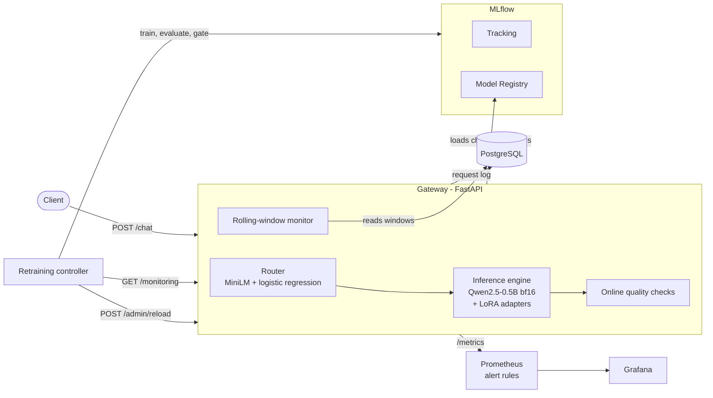

# AdaptOS: Self-Evolving LoRA Switchboard

AdaptOS serves one base LLM with task-specific **LoRA adapters**. A **router** sends each request to the right adapter. An **MLOps control loop** versions, evaluates, deploys and monitors every adapter, and **retrains it automatically** when its answer quality or input distribution degrades.

**Lifecycle:** data versioning → fine-tuning → MLflow tracking & registry → evaluation & promotion gate → deployment with hot-swap → monitoring & alerting → automated retraining

**Stack:** PEFT (LoRA / QLoRA) · Hugging Face Transformers · MLflow 3 · FastAPI · PostgreSQL · Prometheus · Grafana · Docker Compose · GitHub Actions

**Live demo on AWS:** [docs/LIVE_WALKTHROUGH.md](docs/LIVE_WALKTHROUGH.md) (all live links + step-by-step tour, temporary deployment)

**Other docs:** [OVERVIEW.md](OVERVIEW.md) (plain-language summary) · [docs/MANUAL_WALKTHROUGH.md](docs/MANUAL_WALKTHROUGH.md) (local presentation) · [docs/SETUP_NEW_LAPTOP.md](docs/SETUP_NEW_LAPTOP.md) (installation on a new machine)

---

## 1. Architecture



| Component | Responsibility |
|---|---|
| **Data pipeline** | Downloads pinned datasets, cleans and validates them, builds disjoint splits, versions them by content hash |
| **Trainer** | Fine-tunes one LoRA adapter per task (LoRA on CPU, QLoRA on CUDA); logs everything and registers a model version |
| **Evaluator + gate** | Scores candidate vs champion vs base model on fixed sets; promotes only if the gate passes |
| **Router** | Classifies each request into an adapter task or `other` (handled by the base model) |
| **Gateway** | Serves requests, follows registry aliases, hot-swaps and rolls back versions, logs every request |
| **Monitor** | Computes quality and feature drift over a rolling window per adapter; raises alerts |
| **Controller** | Turns alerts into retraining runs, gates the result, hot-swaps the new version |
| **MLflow** | Experiment tracking, dataset lineage, Model Registry (aliases `champion`, `previous`, `challenger`) |
| **Prometheus / Grafana** | Metrics, alert rules, dashboard |

---

## 2. MLOps lifecycle at a glance

| Stage | Implementation | Tracked in |
|---|---|---|
| Data | Pinned sources, validation, deterministic splits, SHA-256 content versions | MLflow experiment `adaptos-data` |
| Training | PEFT LoRA r=8 on attention projections; QLoRA (NF4) on GPU | `adaptos-training` + Model Registry |
| Evaluation | Task metrics on golden + drift sets; candidate vs champion vs base model | `adaptos-evaluation`, per-example predictions |
| Promotion | Rule-based gate; alias-based promotion with one-step rollback | Registry aliases and version tags |
| Deployment | Docker Compose; gateway follows `champion` aliases; zero-downtime hot-swap | `adaptos_live_model_version` metric |
| Monitoring | Reference-free quality checks + feature drift over rolling windows | PostgreSQL request log, Prometheus, Grafana |
| Retraining | Alert → warm-start retraining with rehearsal → gate → hot-swap | `adaptos-retraining` with linked child runs |
| CI | Lint, 101 offline tests, image builds on every push | GitHub Actions |

---

## 3. Technical implementation

### 3.1 Data pipeline and versioning (`src/adaptos/data/`)

| Task | Source (pinned commit) | Input → target |
|---|---|---|
| `sql` | `b-mc2/sql-create-context` | schema + question → SQLite query |
| `summarize` | `knkarthick/dialogsum` | dialogue → 1–2 sentence summary |
| `math` | `openai/gsm8k` (`main`) | word problem → reasoning + `Final answer: <n>` |

**Processing steps:**

- **Format** each raw row into a common `Example {id, task, input, target, meta}` using a task-specific formatter (`formatters.py`).
- **Validate** and reject bad rows, counting each rejection reason:
  - `sql`: the reference query must execute against its schema in an in-memory SQLite database. Untrusted SQL is sandboxed: the schema may only contain `CREATE TABLE`, and the query must be a single `SELECT`/`WITH`.
  - `summarize`: the summary must be shorter than the dialogue.
  - `math`: the answer needs a numeric `####` final answer; GSM8K calculator tags `<<…>>` are stripped.
- **Deduplicate** on a SHA-1 of the normalized input, and **filter by length** against the adapter's `max_seq_len`.
- **Split deterministically** with a seeded shuffle into disjoint sets:

  | Split | Size | Purpose |
  |---|---|---|
  | `train` | 800 | adapter training |
  | `eval` | 200 | eval loss during training |
  | `golden` | 100 | fixed canary set for the promotion gate |
  | `drift_train` | 200 | new labeled data supplied to retraining |
  | `drift_eval` | 100 | measures performance on the new kind of request |

- **Drift slices** are held out by rule, so the first adapters never see them. This simulates a real change in traffic:
  - `sql`: aggregation queries (`COUNT/SUM/AVG/MIN/MAX/GROUP BY`)
  - `summarize`: dialogues with ≥ 14 turns
  - `math`: solutions with ≥ 5 steps
- **Version:** splits are written as LF-normalized JSONL. A `manifest.json` stores the SHA-256 of every file, and `dataset_version = sha256(split hashes)[:12]`.
- **Register** in MLflow (`adaptos-data`) with source revision, sizes, drop counts and all files. Re-registering an existing version is skipped, so rebuilding unchanged data is idempotent. `load_split()` re-verifies the hashes before training uses the data.

### 3.2 Fine-tuning (`src/adaptos/training/train_adapter.py`)

**Model**
- Base model: `Qwen/Qwen2.5-0.5B-Instruct`, pinned revision.
- LoRA adapters: r = 8, α = 16, dropout 0.05 on `q/k/v/o_proj`, about **0.22% trainable parameters**.

**Prompting and loss**
- **Shared prompt builder** (`prompts.py`): training, evaluation and serving all build the chat template the same way, which removes training/serving skew. `PROMPT_VERSION` is logged with every run.
- **Answer-only loss:** prompt tokens get label `-100`, so the model only learns to produce the answer.

**Optimisation**
- Length-grouped batching, which minimises padding.
- AdamW, linear warmup (5%) then linear decay, gradient clipping at 1.0.
- Batch 4 × gradient accumulation 4 = effective batch 16; learning rate 2e-4.

**Backends**
- `lora`: fp32 on CPU.
- `qlora`: 4-bit NF4 base with double quantisation and fp16 compute, plus fp16 autocast and `GradScaler`; CUDA only.
- QLoRA-trained adapters are served on the full-precision base model.

**Logging**
- Parameters: LoRA config, hyperparameters, backend, device.
- Metrics: train loss / learning rate / tokens per second per step; eval loss before and after; peak memory.
- MLflow system metrics: CPU and memory usage.
- Provenance tags: git commit, dataset version, base-model revision, trigger.

**Artifacts**
- LoRA weights.
- `adaptos_info.json`: training parameters and metrics.
- `drift_reference.json`: feature statistics of the training inputs, used by the drift monitor.
- Each run registers a new version of `adaptos-adapter-<task>`.

| Measured (per optimizer step, 16 examples) | CPU, Ryzen 5 5600H, LoRA fp32 | NVIDIA T4, QLoRA |
|---|---|---|
| Time per step | 29–72 s | ~1.3 s |
| Full training, 3 adapters | ~2 h 10 min (estimate) | ~3.5 min |

### 3.3 Experiment tracking and Model Registry

- **MLflow server:** PostgreSQL backend store, with artifacts proxied through the server (`--serve-artifacts`). Clients therefore need no storage credentials.
- **Experiments:** `adaptos-data`, `adaptos-training`, `adaptos-evaluation`, `adaptos-router`, `adaptos-retraining`.
- **Registered models:** `adaptos-adapter-sql`, `adaptos-adapter-summarize`, `adaptos-adapter-math`, `adaptos-router`.
- **Aliases:**
  - `champion`: the version that is served.
  - `challenger`: the version under evaluation.
  - `previous`: the last champion, kept for one-step rollback.
- **Version tags:** dataset version, base revision, prompt version, eval scores, gate decision and reason, trigger. Retrained versions link back to the run that triggered them.
- **Registry helpers** (`registry/adapters.py`): `promote()`, `rollback()`, and a download cache keyed by version.

### 3.4 Evaluation and promotion gate (`src/adaptos/evaluation/`)

**Metrics** (`metrics.py`, all in [0, 1]):
- `sql` **execution match**: predicted and reference queries are run on **5 seeded synthetic SQLite databases** of 30 rows per table, and their result sets are compared (ordered if the reference has `ORDER BY`, otherwise as a multiset). About 35% of rows are generated to satisfy *all* of the reference query's `WHERE` conditions, so empty results cannot hide wrong queries. There is a 2 s query timeout.
  - Validation: deliberately broken reference queries were wrongly accepted only **1–5%** of the time, down from 11–22% with plain random rows. The correct query always matches.
- `summarize` **ROUGE-L F1**: LCS over lowercase tokens, with speaker tags kept.
- `math` **final-answer accuracy**: the `Final answer:` number compared numerically with the reference.

**Evaluation run** (`evaluate.py`):
- Loads the candidate, the champion and optionally the base model into **one engine**.
- Generates greedily on `golden` + `drift_eval`.
- Logs metrics as `{model}/{split}/{metric}`, per-example predictions (JSONL) and a summary, and tags the version with its scores.

**Promotion gate** (`gate.py`). A candidate becomes `champion` only if it:
1. reaches the task's absolute floor on `golden` (`min_score`: sql 0.30, summarize 0.20, math 0.15);
2. does not regress more than `max_regression` = 0.02 on `golden` versus the champion;
3. improves `golden` **or** `drift_eval` by at least `promotion_min_delta`.

On promotion, the old champion becomes `previous`.

### 3.5 Router (`src/adaptos/routing.py`, `training/train_router.py`)

**Model**
- Embeddings: `sentence-transformers/all-MiniLM-L6-v2` (pinned), L2-normalised.
- Classifier: multinomial **logistic regression** with balanced class weights; C is chosen from {0.1, 1, 10} on the eval split.

**Classes and data**
- Classes: `sql`, `summarize`, `math`, and `other`.
- `other` comes from a pinned slice of Dolly-15k (summarisation category excluded); those requests are answered by the plain base model.
- Augmentation: 50% of summarisation training requests have the instruction prefix removed, so the router learns from content rather than a fixed phrase.

**Decision rule**
- If the top label is `other`, or confidence is below **0.6**, the request goes to the base model.
- The 0.6 threshold was chosen by measurement: raising it to 0.8 cost 0.6% accuracy on real requests.

**Storage**
- Saved as **JSON weights** (labels, coefficients, intercepts), not a pickle, so loading a version never executes code.

**Gate and results**
- Gate: test accuracy ≥ 0.95, and not worse than the champion on the same dataset version.

| Router v1 | Accuracy |
|---|---|
| Test set (4 classes) | 99.8% |
| Drifted requests (must keep their task) | 100% |
| Summaries without the instruction prefix | 98.0% |
| Latency (CPU) | ~27 ms per request |

### 3.6 Serving and deployment (`src/adaptos/serving/`, `inference.py`)

**Inference engine**
- One base model is kept in memory in **bfloat16 on CPU**. This was measured at 6.5 tokens/s and 1.36 GB, against 5.3 tokens/s and 2.28 GB for fp32.
- Each task's champion adapter sits on top as a PEFT multi-adapter.
- Generation is greedy, with left padding and batching.

**Model manager**
- Follows the registry's `champion` aliases.
- **Hot-swap without downtime:** the new version is loaded next to the old one, traffic switches, then the old version is unloaded.
- **Rollback** swaps the `champion` and `previous` aliases and hot-swaps.
- **Forced redeploy** restarts a version's monitoring window.
- Models load in a background thread, and `/ready` reports progress.

**Request flow**
1. Route the request.
2. Generate the answer.
3. Score it (§3.7).
4. Log to PostgreSQL: input, output, adapter version, router version, route label / confidence / reason, latency, tokens, quality and feedback.

**API reference:**

| Endpoint | Purpose |
|---|---|
| `POST /chat` | `{"message", "adapter"?, "max_new_tokens"?}` → answer, `adapter@version`, route (label, confidence, reason), `quality` |
| `POST /feedback` | `{"request_id", "rating": "up"\|"down", "correction"?}`: overrides quality and becomes candidate training data |
| `GET /models` | Live router and adapter versions |
| `GET /monitoring` | Window quality, drift (per feature), status and reasons per adapter |
| `POST /admin/reload` | `{"model"?, "force"?}`: follow the registry, or redeploy (`X-Admin-Token`) |
| `POST /admin/rollback` | `{"model"}`: switch back to the previous version (`X-Admin-Token`) |
| `GET /health`, `/ready`, `/metrics` | Liveness; readiness (models, MLflow, database); Prometheus metrics |

### 3.7 Monitoring and alerting (`src/adaptos/monitoring/`)

Live answers have no reference, so each adapter is judged on two signals over its **last 50 requests, served by the live version only** and since its last (re)deployment.

**1. Online quality** (`quality.py`): reference-free checks, combined with user feedback (👍 = 1, 👎 = 0).
- `sql`: the query executes on the request's schema, *and* it uses an aggregate when the question asks for one ("how many", "total", "highest"…).
- `summarize`: the summary-to-dialogue length ratio is in a fixed range (0.10–0.45) derived from the training targets, only speakers present in the dialogue are named, and the summary is not a copy.
- `math`: there is an explicit final answer, and every `a op b = c` step is arithmetically correct.

**2. Feature drift** (`drift.py`)
- Interpretable request features per task:
  - `sql`: asks for an aggregate, question length, number of schema columns.
  - `summarize`: turns, words, speakers.
  - `math`: words, numbers.
- Drift score = **max over features of |window mean − training mean| / training std**.
- The reference statistics are saved **with each adapter version**, so retraining on new data moves the baseline.

**Alert rule:** `samples ≥ 30` and (`quality < quality_min` or `drift > drift_max`). The thresholds in `configs/monitor.yaml` were calibrated on the evaluation outputs:

| Adapter | Online quality: normal → drift slice | Feature drift: normal p99 → drift slice |
|---|---|---|
| `sql` | 0.93 → 0.68 | 0.36 → 2.81 (`asks_aggregate`) |
| `summarize` | 0.90 → 0.87 | 0.37 → 2.52 (`turns`) |
| `math` | 0.87 → 0.79 | 0.45 → 0.86 (`words`) |

Sentence-embedding distance was also evaluated as a drift signal and **rejected**: it did not separate drifted from normal requests.

**Observability**
- The gateway exports Prometheus metrics: `adaptos_routed_requests_total`, `adaptos_router_confidence`, `adaptos_generation_seconds`, `adaptos_quality_score`, `adaptos_window_quality`, `adaptos_window_drift`, `adaptos_window_drift_feature`, `adaptos_adapter_alert`, `adaptos_live_model_version`, `adaptos_model_swaps_total`, `adaptos_feedback_total`, and HTTP metrics.
- Prometheus alert rules: `AdapterDegraded`, `GatewayDown`, `GatewayErrors`.
- A provisioned Grafana dashboard shows adapter status, live versions, quality and drift against threshold lines, drift per feature, routing decisions, feedback and latency.

### 3.8 Automated retraining (`src/adaptos/retraining/`)

**Controller** (`controller.py`): polls `GET /monitoring`. For each adapter in `alert`:

1. **Guardrails:** skip if the adapter was retrained in the last 30 min (cooldown) or has had 3 runs in 24 h (daily cap).
2. **Open a parent run** in `adaptos-retraining`. It records the trigger reason, window quality and drift, and the champion before.
3. **Run the pipeline** (`pipeline.py`):
   - **Warm start** from the champion adapter.
   - **New data:** `drift_train`, plus user corrections from the request log that pass validation (for example, a corrected SQL query must execute on the request's schema).
   - **Rehearsal:** replay an equal number of original training examples (`replay_ratio` = 1.0) to prevent catastrophic forgetting.
   - Train for 2 epochs, then run the standard evaluation and promotion gate.
4. **If promoted,** call `POST /admin/reload`, and the gateway hot-swaps the new version.
5. **Record the outcome** (`promoted` / `rejected` / `failed`). The parent run links to the training and evaluation runs. A failed or rejected run never changes production.

The alert clears without manual action: the monitor only counts the new version's traffic, and its drift reference includes the new data.

### 3.9 Infrastructure (`docker-compose.yml`)

| Service | Image / role | Memory cap |
|---|---|---|
| `gateway` | FastAPI app with CPU PyTorch, models in memory, monitor loop | 2.5 GB |
| `mlflow` | MLflow 3 server (1 worker, background job runner disabled to save ~2 GB) | 512 MB |
| `postgres` | MLflow backend store and request log | 256 MB |
| `prometheus` | Scrapes the gateway every 15 s, evaluates alert rules | 256 MB |
| `grafana` | Provisioned data source and dashboard | 384 MB |

The whole stack uses about 1.5 GB of RAM. Volumes persist the database, artifacts, model cache and metrics. Configuration is versioned YAML in `configs/`; secrets and URLs come from `ADAPTOS_*` environment variables (`.env.example`).

### 3.10 CI and testing

- **GitHub Actions** on every push: `ruff check`, `ruff format --check`, `pytest`, `docker compose config` and image builds.
- **101 tests in 6 files, fully offline:**
  - a tiny randomly initialised Qwen2 model and a character-level tokenizer for training;
  - SQLite in place of PostgreSQL;
  - an in-memory fake Model Registry;
  - a deterministic stand-in for the embedding model.
- **What they cover:** config validation, data splits and tamper detection, answer-only masking, end-to-end training, metrics, gate rules, promote and rollback, routing decisions, gateway API, hot-swap, rollback, quality checks, drift scores, alert rules, schema migration, and controller policies (cooldown, cap, rejected and failed runs).

### 3.11 Reproducibility and lineage

- **Pinned inputs:** every external input is pinned to a commit (datasets, base model, embedding model).
- **Content-hash datasets:** dataset versions are content hashes. Rebuilding on a different machine produced **identical versions**.
- **Run metadata:** every run records its git commit, dataset version, base revision and prompt version.
- **Deterministic retraining:** retraining twice on the same data produced the **same evaluation scores**.
- **Lineage chain:** alert → retraining run → training run → evaluation run → model version → live gateway version.

---

## 4. Results

**Adapters v1** (100 examples per set, primary metric):

| Adapter | Golden: base → adapter | Drift slice: base → adapter |
|---|---|---|
| `sql` (execution match) | 0.45 → **0.70** | 0.34 → 0.18 |
| `summarize` (ROUGE-L) | 0.17 → **0.30** | 0.19 → 0.27 |
| `math` (answer accuracy) | 0.48 → 0.47 | 0.16 → 0.21 |

**Self-healing run (sql).** Aggregation questions were sent to the live v1. The monitor raised an alert (quality 0.776 < 0.80, drift 1.86 > 1.0). The controller retrained, evaluated, promoted and hot-swapped the new version in 6.8 min on a T4 GPU:

| | Before | After automatic retraining |
|---|---|---|
| Golden execution match | 0.70 | **0.80** |
| Drift-slice execution match | 0.18 | **0.47** |
| Same drifted traffic: window quality / drift / status | 0.78 / 1.86 / ALERT | **0.95 / 0.74 / ok** |

---

## 5. Running it

**Requirements:** Python 3.11, Docker Desktop, 16 GB RAM recommended.

```bash
python -m venv .venv
.venv\Scripts\activate          # Linux/macOS: source .venv/bin/activate
python tasks.py install         # dependencies (CPU PyTorch)
python tasks.py up              # PostgreSQL, MLflow, gateway, Prometheus, Grafana
python tasks.py data            # build and register datasets
python tasks.py train           # train adapters on CPU (LoRA)
# on an NVIDIA GPU instead: python -m adaptos.training.train_adapter --adapter all --device cuda --backend qlora
python tasks.py evaluate        # evaluate + promotion gate -> champion aliases
python tasks.py router          # train and register the router
python tasks.py controller      # optional: watch alerts and retrain automatically
python scripts/demo.py          # guided end-to-end demo
```

| Service | URL |
|---|---|
| Gateway API (Swagger) | http://localhost:8000/docs |
| MLflow | http://localhost:5000 |
| Grafana (admin / admin) | http://localhost:3000 |
| Prometheus | http://localhost:9090 |

Other tasks: `python tasks.py test | lint | format | ps | logs | down`. `reset` deletes all volumes.

---

## 6. Project structure

```
configs/
  base.yaml              base model, backends, router, retraining, serving
  adapters/*.yaml        per-task dataset, LoRA, training, evaluation, generation settings
  monitor.yaml           window size, thresholds, cooldown
src/adaptos/
  config.py              typed configuration (pydantic): YAML + ADAPTOS_* env vars
  prompts.py             single prompt builder for training, evaluation and serving
  inference.py           multi-adapter inference engine
  routing.py             router model and decision rule
  data/                  formatters, pipeline, dataset IO and integrity checks
  training/              adapter training, tokenization, router training
  evaluation/            metrics, evaluation run, promotion gate
  registry/              MLflow registry helpers (promote, rollback, cached download)
  serving/               FastAPI app, model manager, request store
  monitoring/            online quality, feature drift, window monitor, Prometheus metrics
  retraining/            retraining pipeline and controller
scripts/                 demo.py (guided demo), simulate_traffic.py (normal / drifted traffic)
docker/                  gateway and MLflow Dockerfiles
infra/                   PostgreSQL init, Prometheus config + alert rules, Grafana provisioning
tests/                   101 offline tests
tasks.py                 cross-platform task runner
```

---

## 7. Design decisions and limitations

| Decision | Reason |
|---|---|
| PEFT multi-adapter serving instead of vLLM | No local NVIDIA GPU; the training backend is configurable (`lora` / `qlora`) |
| bf16 inference on CPU | Measured faster and 40% smaller than fp32 |
| Feature drift instead of embedding drift | Embedding drift did not separate the data (measured) |
| Drift reference stored per adapter version | Retraining on new data automatically updates the baseline |
| Warm start + rehearsal for retraining | Learns the new request type without forgetting the old one |
| Router stored as JSON | Loading a registry version never executes code |

**Limitations**
- The 0.5B base model limits accuracy. The math adapter adds no accuracy over the base model and mainly teaches the answer format.
- Online quality checks are calibrated heuristics; for `summarize`, drift is the stronger signal.
- Retraining data comes from a held-out labeled pool that stands in for a labeling team. User corrections are supported but were not exercised in the experiments.
- The gateway generates sequentially in one process; a GPU server such as vLLM with multi-LoRA would be needed for higher throughput.
